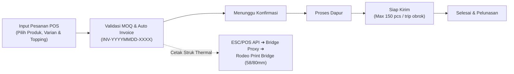

<div align="center">
  
  <h1>Sistem Informasi Berkat Dinasti</h1>
  <p>
    <strong>Sistem Manajemen Pesanan Pre-Order, Kasir POS, Kanban Produksi &amp; Cetak Struk Thermal ESC/POS</strong><br />
    Platform operasional internal untuk UMKM Bakery &amp; Pastry — <em>Dynasty Food &amp; Beverage</em> (Kota Batu &amp; Malang Raya)
  </p>

  <p>
    
    
    
    
    
  </p>

  <p>
    <a href="https://ex5.ucing4k.my.id/">🌐 Live Preview</a>
    &nbsp;•&nbsp;
    <a href="https://www.figma.com/proto/nyxxCopYBjWGphWFkbYawy/SISFOR---BERKAT-DINASTI?node-id=10-841&t=5CYRnaYdXR7Nwk3x-1&scaling=min-zoom&content-scaling=fixed&page-id=0%3A1">🎨 Prototype Figma</a>
    &nbsp;•&nbsp;
    <a href="#-fitur--modul-utama">✨ Fitur Utama</a>
    &nbsp;•&nbsp;
    <a href="#-panduan-setup-lokal">🛠️ Setup Lokal</a>
    &nbsp;•&nbsp;
    <a href="docs/00_Berkat_Dinasti_Index.md">📚 Dokumentasi</a>
  </p>
</div>

---

## 📌 Ringkasan Sistem

**Sistem Informasi Berkat Dinasti** dirancang khusus sebagai **dashboard internal Admin &amp; Staf Operasional** (tanpa portal *e-commerce* publik, karena pemesanan pelanggan tetap dilayani melalui WhatsApp dan transaksi langsung). Sistem ini menggantikan pencatatan nota manual dengan alur operasional terpusat mulai dari input pesanan *pre-order* (PO), penentuan topping &amp; kemasan, pemantauan produksi dapur, penjadwalan kurir motor obrok, pencatatan piutang pelanggan, cetak struk thermal Bluetooth, hingga pelaporan arus kas.

### Aturan Bisnis Inti
| Aspek Operasional | Ketentuan Sistem |
| :--- | :--- |
| **Penomoran Invoice** | Dibuat otomatis dengan format standar `INV-YYYYMMDD-XXXX` (contoh: `INV-20261117-0001`). |
| **Katalog Tanpa Beban Foto** | Tabel master produk menampilkan nama, kategori, varian kemasan, MOQ, dan harga tanpa foto produk untuk mempercepat akses admin—dilengkapi pop-up referensi visual khusus **9 Pilihan Topping Roti Hajatan**. |
| **Pengiriman &amp; Armada Obrok** | **Bebas Ongkir (Rp 0)** untuk seluruh area Kota Malang &amp; Kota Batu, dengan kapasitas kurir sepeda motor obrok maksimal **150 pcs roti per trip**. |
| **Pembayaran &amp; Piutang** | Mendukung skema **Lunas**, **DP**, dan **Hutang**; selisih tagihan otomatis terakumulasi ke kolom `total_hutang` pada data pelanggan. |

---

## ✨ Fitur &amp; Modul Utama

| Modul | Halaman | Deskripsi Fungsional |
| :--- | :--- | :--- |
| **Autentikasi &amp; Sesi** | `public/login.php`<br>`public/reset-password.php` | Login multi-role berbasis `bcrypt` &amp; `session_regenerate_id`, proteksi rute per halaman, serta fitur *Remember Me* bertanda tangan HMAC-SHA256 (`7 hari`) dengan tema *Warm Artisan Bakery*. |
| **Beranda Operasional** | `public/beranda.php` | 4 KPI Card *real-time* (pesanan hari ini, pending, pemasukan bulanan, pelanggan aktif), widget pesanan prioritas &amp; pengiriman hari ini, pintasan langsung ke mode POS, dan ekspor rekap harian (`.csv` UTF-8 BOM). |
| **Pesanan, POS &amp; Kalender** | `public/pesanan.php` | **Mode Kasir POS Terpadu** (`?view=tambah_pesanan`) dengan validasi MOQ &amp; modal pemilih **9 Topping Roti Hajatan**, **Kanban Board 4 Swimlane** (`Menunggu Konfirmasi` ➔ `Proses Dapur` ➔ `Siap Kirim` ➔ `Selesai`), serta **Kalender Deadline Pengiriman** untuk mencegah keterlambatan produksi. |
| **Katalog Master Produk** | `public/produk.php` | Sinkronisasi 1:1 katalog resmi UMKM (Roti Hajatan 9 Topping, Bolu Pisang/Non-Pisang Premium, Roti Kopi, Roti Bijian Besar &amp; Kecil) beserta varian kemasan (`Kardus Putih`, `Kardus Coklat`, `Kardus Batik`, `Mika`, `Satuan`), status ketersediaan, dan pop-up foto katalog topping. |
| **CRM Pelanggan &amp; Piutang** | `public/pelanggan.php` | Direktori pelanggan `Retail` &amp; `Reseller`, riwayat transaksi lengkap, pelacakan saldo piutang (`total_hutang`), dan tautan cepat *click-to-chat* WhatsApp. |
| **Laporan &amp; Keuangan** | `public/laporan.php` | *(Khusus Admin)* Filter periode bulanan &amp; rentang tanggal kustom, grafik tren omzet, proporsi pembayaran Lunas vs Hutang, rekap kas operasional, dan ekspor laporan. |
| **Pengaturan &amp; User** | `public/pengaturan.php` | *(Khusus Admin)* Konfigurasi profil toko &amp; logo, **Simulator Struk Thermal 58mm / 80mm**, serta manajemen akun pengguna (**Admin** &amp; **Staf Operasional**). |
| **Thermal Print Bridge** | `public/api/get-escpos-data.php`<br>`android-print-bridge/` | Endpoint JSON ESC/POS (58mm/80mm) dengan logo &amp; rincian topping (`* Top: ...`), klien JS (`public/assets/js/bluetooth-print.js`), *iframe proxy* (`public/bridge-proxy.html`) untuk bypass *Mixed Content* HTTPS ➔ localhost, dan aplikasi pendamping **Rodeo Print Bridge** (`port 8080`). |

---

## 🔐 Kontrol Akses Berbasis Peran (2-Role RBAC)

Sistem menerapkan pembatasan akses di sisi antarmuka maupun validasi server PHP untuk memisahkan kewenangan pemilik usaha dan staf operasional harian:

| Modul / Aksi | Admin / Pemilik (`admin`) | Staf Operasional / Kasir (`kasir`) |
| :--- | :---: | :---: |
| **Beranda &amp; Ringkasan KPI** | ✅ Akses Penuh | ✅ Akses Penuh |
| **Pesanan, POS, Kanban &amp; Kalender** | ✅ CRUD &amp; Update Status | ✅ Input Pesanan, Pembayaran &amp; Update Status |
| **Katalog Produk &amp; Harga** | ✅ Full CRUD &amp; Reset Katalog Resmi | 👁️ View Only (Tambah/Edit/Hapus diblokir) |
| **Data Pelanggan &amp; Piutang** | ✅ Akses Penuh | ✅ Operasional Pelanggan |
| **Laporan Keuangan &amp; Omzet** | ✅ Akses Penuh &amp; Ekspor | ⛔ Akses Ditolak (Redirect ke Beranda) |
| **Pengaturan Toko &amp; Manajemen User** | ✅ Akses Penuh | ⛔ Akses Ditolak (Redirect ke Beranda) |

---

## 🧁 Alur Pesanan &amp; Katalog Produk Resmi



<details>
<summary><strong>📋 Rincian Katalog Resmi &amp; 9 Varian Topping Roti Hajatan</strong></summary>

1. **Roti Hajatan (7 Kelopak — 9 Pilihan Topping):** `Kardus Putih` (Rp 10.000), `Kardus Coklat` (Rp 10.000), `Kardus Batik` (Rp 11.000), `Mika` (Rp 11.000).
   - *9 Topping Resmi:* `Coco Chip + Keju`, `Coco Chip + Wijen`, `Meses + Keju`, `Meses + Wijen`, `Wijen + Keju`, `Meses + Sprinkle`, `Coco Chip + Sprinkle`, `Wijen`, `Wijen + Sprinkle` *(plus opsi `Campur / Mix` &amp; `Tanpa Topping`)*.
2. **Bolu Pisang Premium:** `Kardus Coklat` (Rp 21.000), `Mika` (Rp 22.000).
3. **Bolu Tanpa Pisang Premium:** `Kardus Putih` (Rp 19.000), `Mika` (Rp 20.000).
4. **Roti Manis:** `Roti Kopi` (Rp 4.000, MOQ 50 pcs), `Roti Bijian Besar` (Rp 4.000, MOQ 20 pcs), `Roti Bijian Kecil` (Rp 3.000, MOQ 50 pcs).

</details>

---

## 🏗️ Arsitektur Teknis &amp; Struktur Proyek

### Tech Stack
- **Backend:** PHP 8+ Native (`PDO` &amp; `MySQLi` dengan *prepared statements*), lengkap dengan deteksi lingkungan otomatis di `config/config.php` (`localhost`/`127.0.0.1` vs server produksi cPanel) serta *self-healing schema check* untuk kolom `detail_pesanan.topping`.
- **Frontend:** Tailwind CSS (CDN), custom stylesheet `public/css/modern-craft.css` (*Modern Craft &amp; Warm Artisan Dark Chocolate*), tipografi **Inter**, dan **Vanilla JavaScript**.
- **Database:** MySQL (`database/berkat_dinasti_final.sql`) terdiri dari **13 tabel fisik** (`T1`–`T13`), **7 database views** (`v_detail_pesanan_produk`, `v_katalog`, `v_laporan_harian`, `v_laporan_kas_harian`, `v_pesanan_lengkap`, `v_piutang`, `v_ringkasan_kas`), serta **triggers &amp; stored procedures** untuk sinkronisasi subtotal, piutang, stok, dan arus kas.
- **Thermal Printing Bridge:** Endpoint `public/api/get-escpos-data.php` + `public/assets/js/bluetooth-print.js` + `public/bridge-proxy.html` + proyek Android `android-print-bridge/` (`Rodeo Print Bridge.apk`).

### Struktur Direktori
```text
Berkat-Dinasti/
├── .github/workflows/main.yml      # Pipeline CI/CD Auto-Deploy ke cPanel via SSH
├── .htaccess                       # Proteksi directory listing & redirect root ke public/login.php
├── index.php                       # Entry point redirect ke public/login.php
├── config/
│   ├── config.php                  # Smart environment detection (Localhost vs Production)
│   └── database.php                # Konfigurasi koneksi database
├── database/
│   ├── berkat_dinasti_final.sql    # Skema baseline lengkap (13 tabel, 7 views, triggers, SP, seed)
│   ├── migration_update.sql        # Migrasi sinkronisasi pricelist & admin
│   ├── migration_add_topping.sql   # Migrasi kolom topping pada detail_pesanan
│   └── migration_add_kasir_user.sql# Migrasi seed akun staf operasional (kasir)
├── public/
│   ├── beranda.php                 # Dashboard KPI & rekap harian
│   ├── pesanan.php                 # POS terpadu, Kanban 4 swimlane & kalender deadline
│   ├── produk.php                  # Master katalog produk, varian kemasan & MOQ
│   ├── pelanggan.php               # CRM pelanggan, riwayat & pelacakan piutang
│   ├── laporan.php                 # Laporan penjualan, omzet & arus kas (Admin only)
│   ├── pengaturan.php              # Profil toko, simulator struk & manajemen user (Admin only)
│   ├── login.php / logout.php / reset-password.php
│   ├── bridge-proxy.html           # Iframe proxy bypass Mixed Content HTTPS -> localhost:8080
│   ├── api/get-escpos-data.php     # Generator JSON & ESC/POS thermal 58mm/80mm
│   ├── assets/                     # Ikon SVG, gambar katalog topping, logo, bluetooth-print.js
│   └── css/modern-craft.css        # Design tokens & custom styling tema bakery
├── android-print-bridge/           # Source proyek Android Print Bridge (Bluetooth ESC/POS)
├── Rodeo Print Bridge.apk          # Installer APK siap pasang untuk perangkat kasir Android
└── docs/                           # Knowledge base terstruktur (Obsidian Vault: DFD, Fitur, UI/UX, QA)
```

---

## 🚀 CI/CD Auto-Deployment

Repositori ini menggunakan **GitHub Actions** (`.github/workflows/main.yml`) dengan protokol **SSH Remote Execution** (`appleboy/ssh-action@v1.0.3`):
1. Setiap `push` ke branch `main` memicu job deploy otomatis pada runner `ubuntu-latest`.
2. Runner terhubung ke server cPanel melalui SSH dan mengeksekusi sinkronisasi langsung di direktori produksi:
   ```bash
   git fetch origin main
   git reset --hard origin/main
   ```
3. **GitHub Repository Secrets yang diperlukan:** `SSH_HOST`, `SSH_PORT`, `SSH_USER`, dan `SSH_PASSWORD` (atau `SSH_KEY`).

> ⚠️ **Wajib Sebelum Push ke `main`:** Jalankan pemeriksaan sintaks PHP (`php -l`) pada setiap file yang diubah agar tidak menimbulkan *HTTP 500* di server produksi.

---

## 🛠️ Panduan Setup Lokal

Ikuti langkah berikut untuk menjalankan sistem di lingkungan pengembangan lokal (**XAMPP** / **Laragon**):

1. **Clone repositori** ke folder `htdocs` (XAMPP) atau `www` (Laragon) dengan nama direktori `Berkat-Dinasti` agar sesuai dengan `BASE_URL` lokal di `config/config.php`:
   ```bash
   git clone https://github.com/uCing4K/Berkat-Dinasti-Sisfor.git Berkat-Dinasti
   cd Berkat-Dinasti
   ```
2. **Buat database MySQL** baru bernama `berkat_dinasti` melalui phpMyAdmin atau MySQL CLI.
3. **Import skema baseline** dari [`database/berkat_dinasti_final.sql`](database/berkat_dinasti_final.sql) ke database `berkat_dinasti`.
   *(Jika memperbarui database lama yang belum sinkron, jalankan juga skrip migrasi `migration_update.sql`, `migration_add_topping.sql`, dan `migration_add_kasir_user.sql` secara berurutan).*
4. **Jalankan Apache &amp; MySQL**, lalu akses aplikasi melalui browser:
   ```text
   http://localhost/Berkat-Dinasti/
   ```
   *(File `config/config.php` otomatis mendeteksi host `localhost`/`127.0.0.1` dengan kredensial standar `root` tanpa password, serta `BASE_URL` ke `http://localhost/Berkat-Dinasti/public/`).*
5. **Verifikasi akun awal:** Skema baseline menyertakan akun default role `admin` dan `kasir` pada tabel `pengguna`. Segera ubah kata sandi melalui menu **Pengaturan** saat digunakan di lingkungan produksi.

---

## 📚 Dokumentasi Terkait

Seluruh dokumentasi perancangan dan audit tersimpan terstruktur di folder [`docs/`](docs/00_Berkat_Dinasti_Index.md):
- [**01. Arsitektur Sistem &amp; DFD**](docs/01-Architecture/README.md) — DFD Level 0–2, Kamus Data Store (`T1`–`T13`), dan Matriks RBAC.
- [**02. Spesifikasi Fitur &amp; Workflow**](docs/02-Features/README.md) — Site map, aturan armada, 9 topping roti hajatan, dan *sequence diagram*.
- [**03. Panduan UI/UX &amp; Design System**](docs/03-UI-UX-Guidelines/README.md) — Keputusan desain, tipografi **Inter**, hasil *usability testing*, dan tautan Figma.
- [**04. Changelog &amp; Laporan QA**](docs/04-Changelogs/README.md) — Riwayat versi (`v1.0.0` s.d. `v1.2.0`) dan log audit bug.
- [**Panduan Setup Print Bridge**](android-print-bridge/android-print-bridge/SETUP_GUIDE.md) — Konfigurasi printer Bluetooth thermal untuk Android Print Bridge.

---

<div align="center">
  <sub>© 2026 <strong>Berkat Dinasti (Dynasty Food &amp; Beverage)</strong> — Developed with ❤️ for UMKM Bakery &amp; Pastry Operations.</sub>
</div>
